<div align="center">

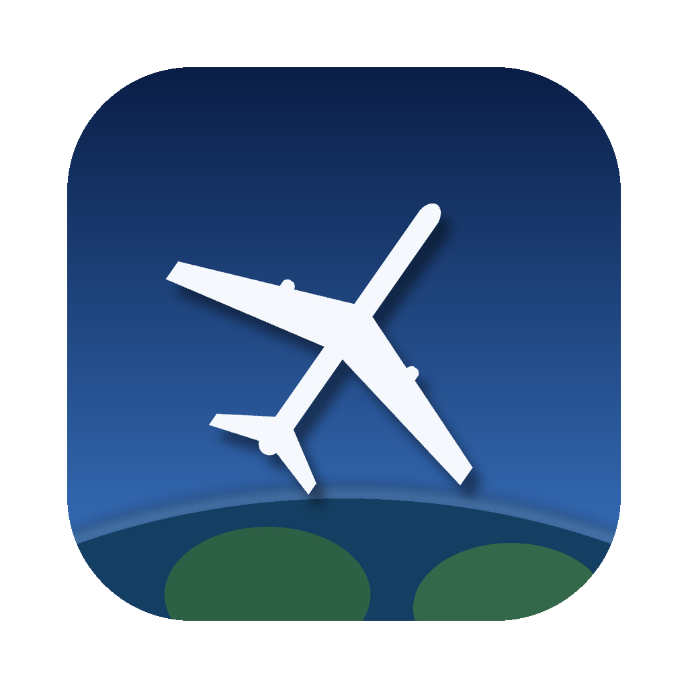

# GeoFlight

### The world is yours to explore.

Take off from any of thousands of real airports and fly over a photorealistic,
geographically accurate Earth, from city skylines to mountain ranges, at any hour of the day.

**[Download for macOS](https://github.com/RatikGambhir/flight-simulator/releases/latest)** ·
[Explore the features](#built-for-the-joy-of-flying) ·
[See the gallery](#fly-the-skylines-you-know-by-heart)

<sub>Free and open source (MIT) · macOS 13 Ventura or later · Universal: Apple Silicon + Intel</sub>

<br />

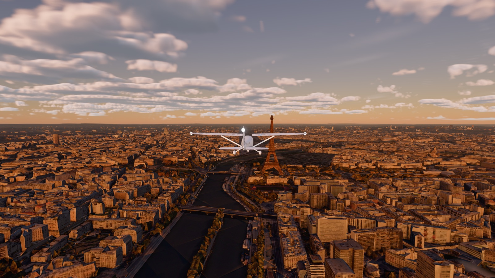

<sub>Paris at golden hour. Every gameplay image in this README is an unedited frame captured inside GeoFlight.</sub>

</div>

| ~9,600 | 9 | 2,500+ | 120 Hz |
| :---: | :---: | :---: | :---: |
| real airports | aircraft to fly | cities in 3D | flight physics |

---

## Explore the entire world

**Every coastline. Every peak. Every city.** GeoFlight streams a geographically accurate Earth
around you as you fly, so the view out the window is the real one, wherever you point the nose.

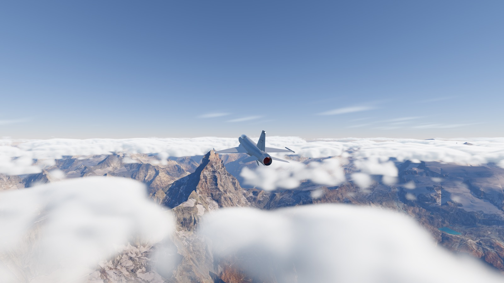

- **Go anywhere.** Start on a runway at any of ~9,600 real airports, on final approach, or drop in
  mid-air above any point on the globe.
- **Real terrain.** Streamed elevation and imagery at true height. You land on the actual runway,
  rooftop or mountainside under your wheels.
- **Cities in full 3D.** Google Photorealistic 3D Tiles put real buildings and landmarks in more than
  2,500 cities.
- **Day and night.** The sun and moon sit where they really are for today's date, stars come out at
  dusk, and you can pick any hour.
- **Living skies.** Volumetric clouds drift with the wind and cast shadows. Turn on live weather for
  real cloud, rain, snow and wind.

> Photorealistic 3D cities use your own Google Map Tiles API key (or a Cesium ion token), added in
> **Settings → World data**. Without a key, the free **Open data** mode flies over real terrain and
> satellite imagery, with no 3D buildings.

## Fly the skylines you know by heart

Captured in-game at Ultra quality: no renders, no retouching. Just the simulator, a camera angle
and the right time of day.

| | |
| --- | --- |
| 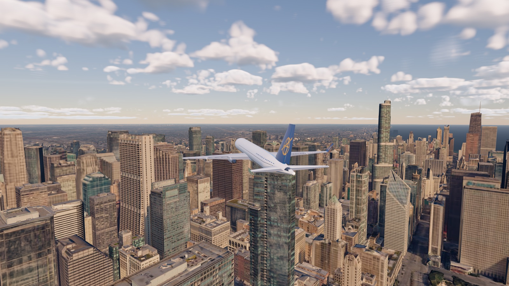 | 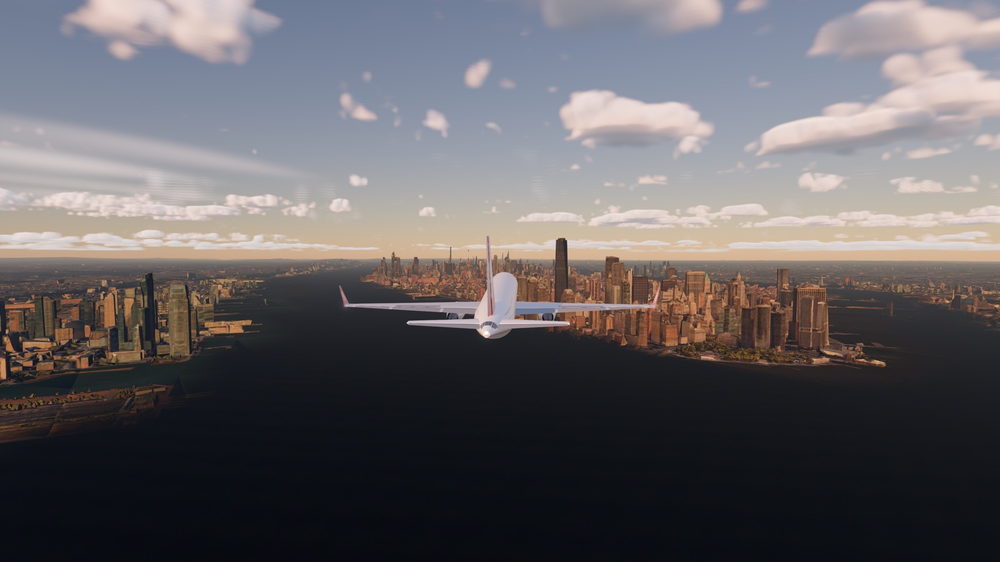 |
| **Chicago** · Lake Michigan · 737 at 1,500 ft | **New York City** · Hudson River · A320 at 1,100 ft |
| 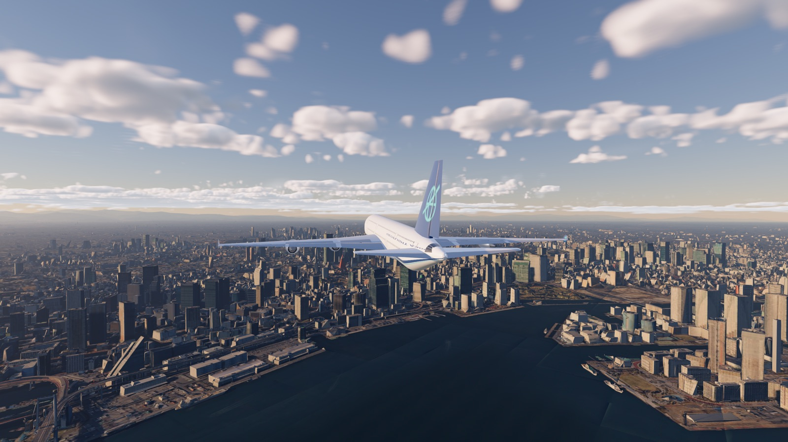 |  |
| **Tokyo** · Minato · A380 at 1,700 ft | **Paris** · The Seine · Skyhawk at 950 ft |

<sub>Scenery: Google Photorealistic 3D Tiles. Imagery © Google and its data providers.</sub>

## Built for the joy of flying

**Easy to pick up. Hard to put down.** Real flight physics under a control scheme you learn in a
minute. Hand the hard parts to the autopilot, or fly every mile yourself.

- **An autopilot that flies the whole trip.** Choose a destination and press `Z`. It taxis, takes
  off, climbs, cruises the great circle, descends and lands, picking a runway from the wind. If an
  approach isn't stable, it goes around and tries again.
- **One set of controls.** The same keys fly every aircraft, and a tap is a small correction.
  Gamepads work too.

  | Pitch | Roll | Throttle | Gear | Autopilot |
  | :---: | :---: | :---: | :---: | :---: |
  | `W` `S` | `A` `D` | `R` `F` | `G` | `Z` |

- **Takeoffs and landings.** Line up on a real runway, rotate at the speed on your aircraft card, and
  flare into ground effect. Every touchdown gets a rating.
- **Fly somewhere.** Search for an arrival airport, follow its bearing on the compass, watch your
  progress on the live route map, or skip ahead to any distance out.
- **Help when you want it.** Assisted flight holds your path, levels the wings and protects against
  stalls. Switch to Direct for the unfiltered airplane.
- **Six ways to watch.** Exterior, Cockpit, Wing, Free look, Cinematic and Flyby cameras, plus drag
  to orbit or look around the flight deck.

## From first light to starlight

Fly with the real sun and moon for today's date, or pick any hour. Every scene is lit by the same
physically based sky.

| Long haul | Sunset | Night |
| --- | --- | --- |
| 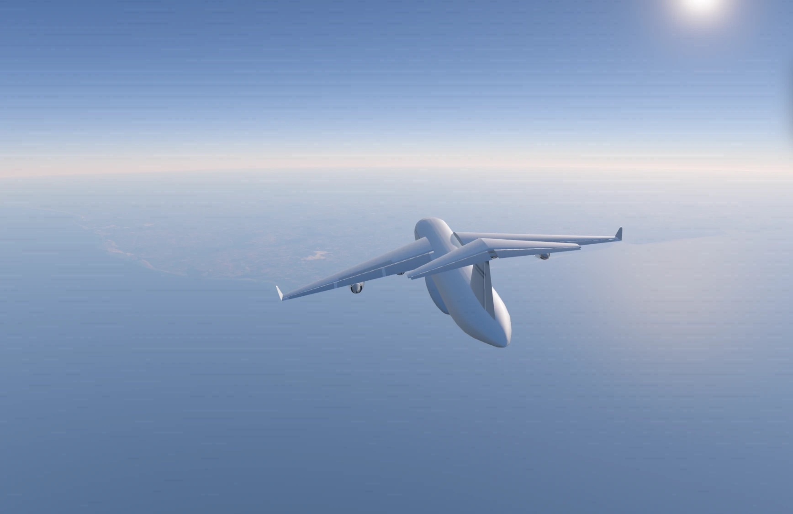 | 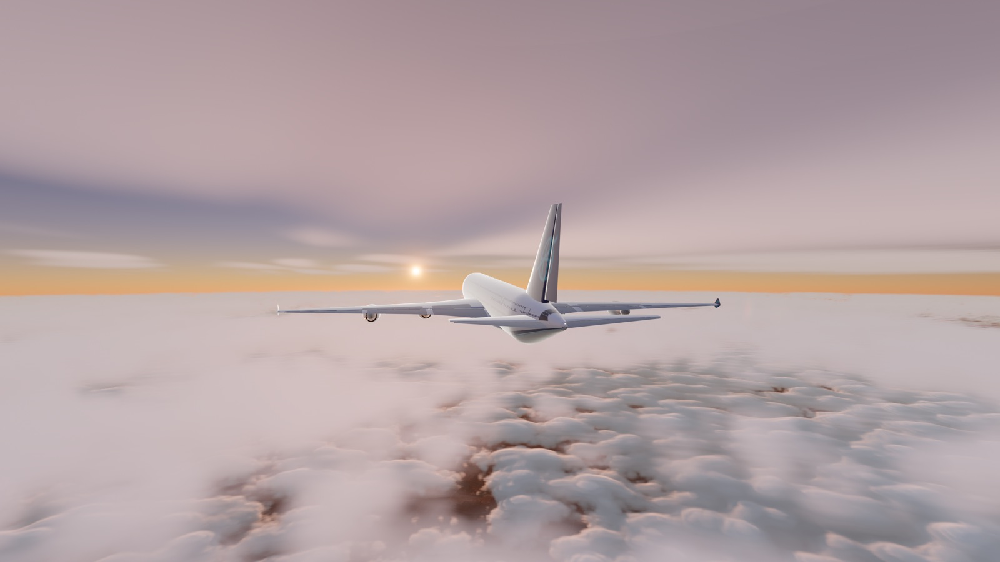 | 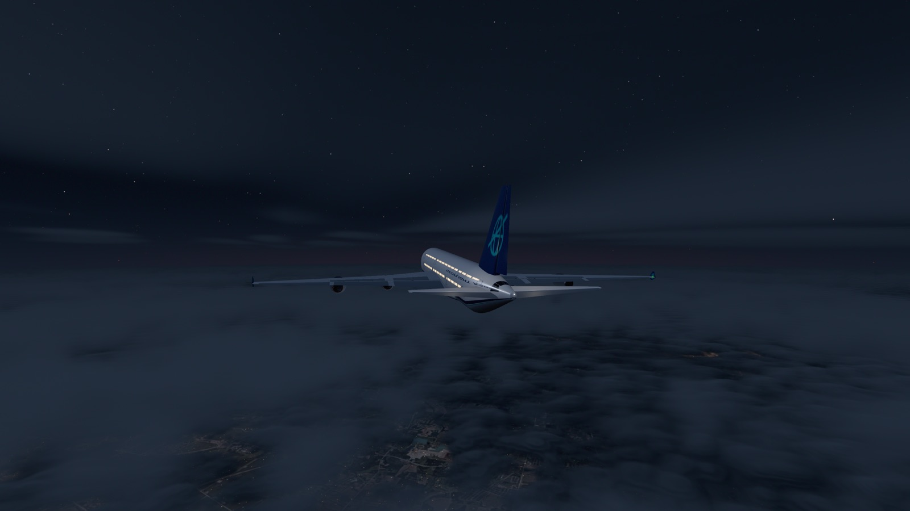 |
| Over the English Channel at cruise altitude, the coastline fades into blue haze. | Volumetric clouds glow as the sun sinks, and exposure adapts the way your eyes would. | Stars keep their real positions and brightness; the moon shows today's phase. |

- **Real sky physics:** precomputed atmospheric scattering for sky, sun and aerial perspective.
- **Volumetric clouds:** weather-driven layers that drift with the wind and shade the ground.
- **Living aircraft:** hinged flaps, ailerons and spoilers, spinning fans, retracting gear, nav and
  strobe lights.
- **Cinematic finish:** AgX tone mapping, lens flare and smooth anti-aliasing on every frame.

## The hangar

**Nine aircraft. One sky.** From a four-seat trainer to the world's largest airliner, a business jet
and an F-16. Each has its own weight, performance and handling, and its own painted liveries.

| | | |
| :---: | :---: | :---: |
| 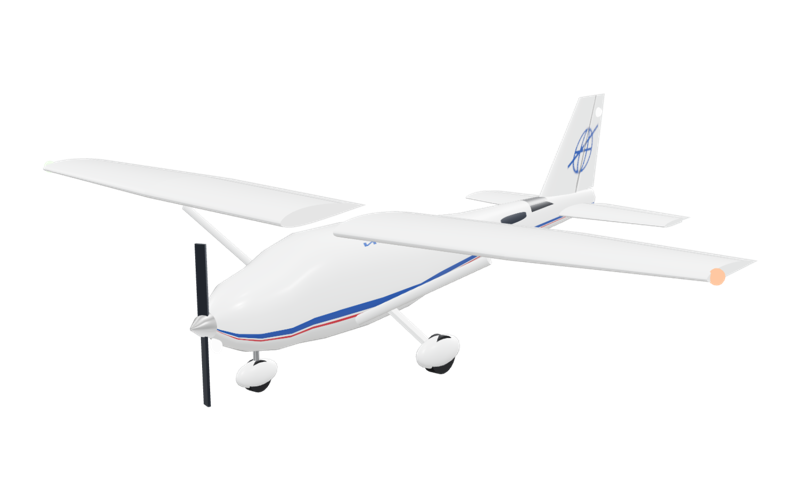<br />**Skyhawk style**<br /><sub>General aviation · 115 kt · 5,500 ft</sub> | 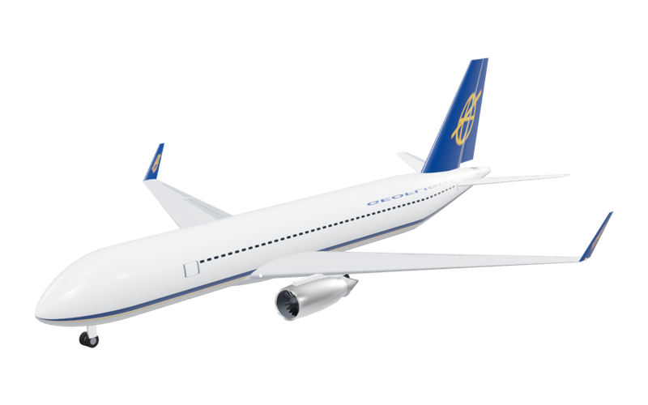<br />**737-800 style**<br /><sub>Airliner · 290 kt · FL350 · full flight deck</sub> | 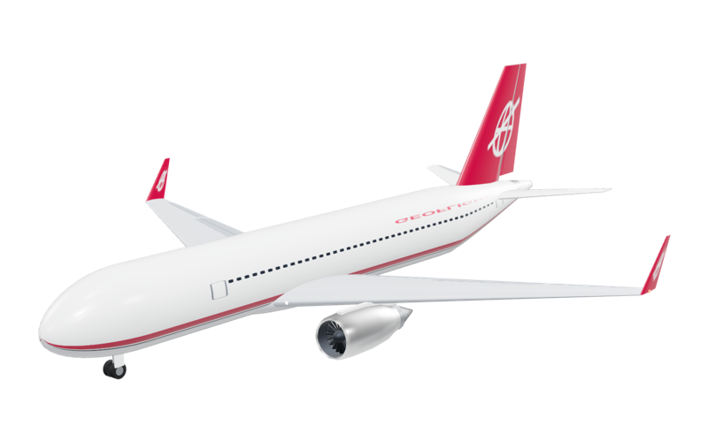<br />**A320neo style**<br /><sub>Airliner · 280 kt · FL360</sub> |
| 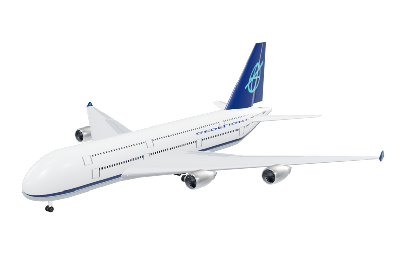<br />**Airbus A380-800**<br /><sub>Airliner · 290 kt · FL370</sub> | 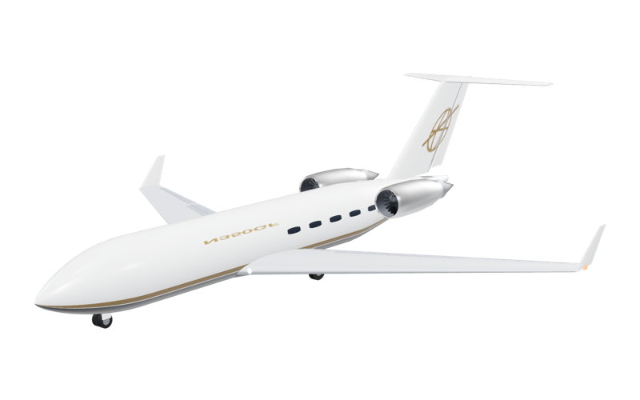<br />**Midsize business jet**<br /><sub>Business jet · 300 kt · FL410</sub> | 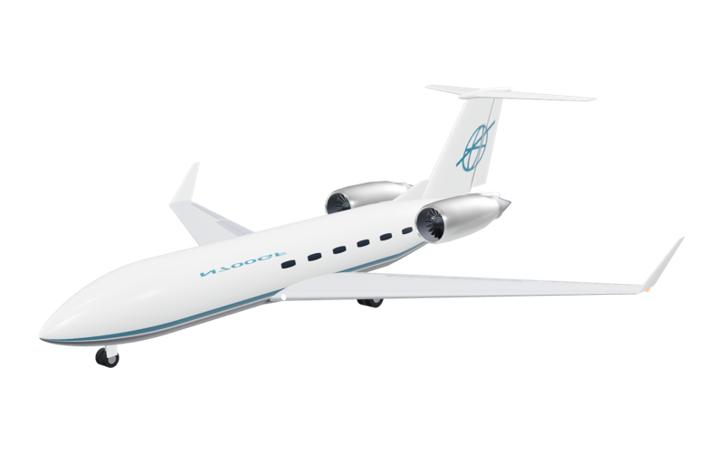<br />**Longitude style**<br /><sub>Business jet · 250 kt · FL410</sub> |
| 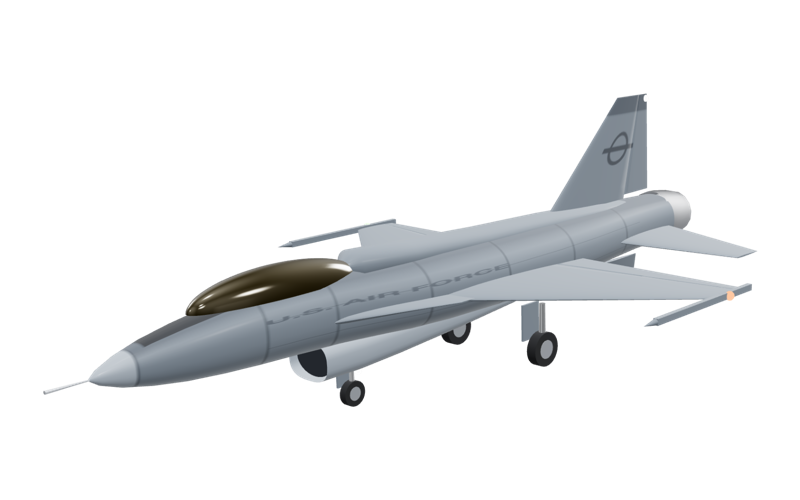<br />**F-16C style**<br /><sub>Fighter · 9 g · Mach 2 at altitude</sub> | 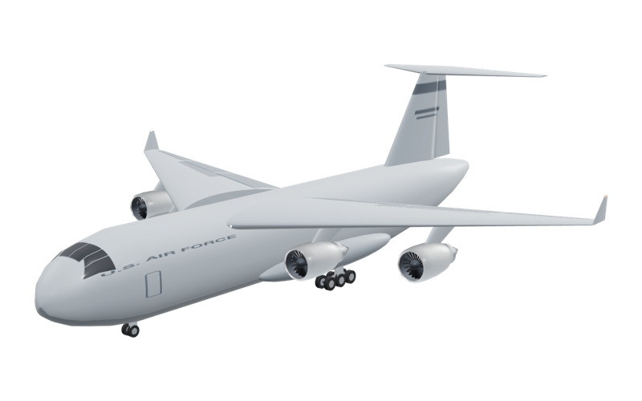<br />**C-17 Globemaster III**<br /><sub>Military airlifter · 282 kt · FL330</sub> | 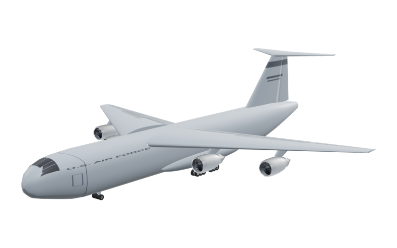<br />**C-5M Super Galaxy**<br /><sub>Military airlifter · 275 kt · FL330</sub> |

<sub>Cruise figures are indicated airspeed. Aircraft are original procedural models in the style of each type, not licensed replicas.</sub>

## Your window seat is waiting

**[Download GeoFlight for macOS](https://github.com/RatikGambhir/flight-simulator/releases/latest)**,
pick an airport, and see where the afternoon takes you.

| Platform | Status |
| --- | --- |
| macOS | ✅ macOS 13 Ventura or later · Universal (Apple Silicon + Intel) · `.dmg` on [GitHub Releases](https://github.com/RatikGambhir/flight-simulator/releases) |
| Windows | No release yet |
| Linux | No release yet |

The macOS build isn't notarized yet. The first time you open it, right-click **GeoFlight** in
Applications and choose **Open**.

---

## Repository

This repository holds two independent projects:

```
app/    The GeoFlight simulator: Tauri 2 + Rust (simulation) and React + Three.js (rendering)
site/   The marketing website: React, TypeScript, Tailwind CSS, shadcn/ui and Motion
```

Each has its own `package.json` and lockfile. Install and run them separately, or use the
shortcuts in the root `package.json`:

```bash
npm --prefix app install && npm --prefix site install
```

```bash
npm run app:dev
```

```bash
npm run site:dev
```

How the pieces fit together (runtime design, where each piece of logic lives, contracts between Rust
and the frontend, and the website's structure) is in **[ARCHITECTURE.md](ARCHITECTURE.md)**. The
simulator's developer guide (prerequisites, world-data keys, controls, autopilot, tests) lives in
**[app/README.md](app/README.md)**. The website runs at
http://localhost:5180 and builds to `site/dist/` with `npm run site:build`.

## Credits

Airports and runways: [OurAirports](https://ourairports.com/data/) (public domain). Cities and
coastlines: [Natural Earth](https://www.naturalearthdata.com) (public domain). Geoid: EGM96.
Atmosphere and clouds build on [Takram's three-geospatial](https://github.com/takram-design-engineering/three-geospatial);
3D Tiles streaming on [3DTilesRendererJS](https://github.com/NASA-AMMOS/3DTilesRendererJS). Scenery
© Google, Cesium, Esri, EOX and AWS per their terms. See [app/README.md](app/README.md#data-sources--licences)
for the full list.

GeoFlight is released under the MIT License.
